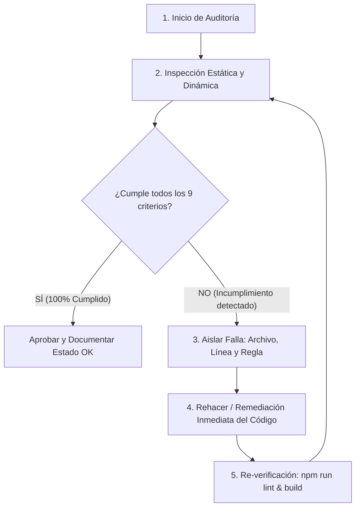

# Auditor y Remediador de Seguridad (Security Auditor & Remediator)

Esta skill garantiza que el código sea invulnerable y cumpla estrictamente con los estándares de seguridad para comercio electrónico y productos digitales. No es solo un verificador pasivo: **si algo no cumple, identifica el punto exacto de fallo y reescribe el código para corregirlo en el acto.**

---

## Cuándo se debe ejecutar (Regla de Ejecución Obligatoria)

La skill debe ejecutarse **siempre** en los siguientes momentos:
1. **Tras cualquier modificación de código** en rutas de compra, pagos, checkout o autenticación.
2. **Antes de crear un commit o realizar un `git push`**.
3. **Al agregar nuevas rutas API, Server Actions o endpoints de administración**.
4. **Cuando el usuario pida verificar la seguridad del sistema**.

---

## Matriz de Cumplimiento de Seguridad (Security Rules Checklist)

Toda auditoría evalúa obligatoriamente estos 9 pilares:

| Regla | Nombre | Criterio de Cumplimiento Estricto |
|---|---|---|
| **R1** | **Zero-Trust en Precios** | Los precios, totales y subtotales **NUNCA** se toman del cliente (`request.body`). Siempre se calculan en el servidor consultando la base de datos por `id`. |
| **R2** | **Acceso de Admin Estricto** | Las rutas y APIs de `/admin` exigen autenticación criptográfica y pertenencia explícita a la lista blanca de correos autorizados (`isAllowedAdminEmail`). La UI pública no filtra elementos de admin a usuarios anónimos ni a clientes normales. |
| **R3** | **Protección CSRF / Same-Origin** | Toda mutación (`POST`, `PUT`, `DELETE`, `PATCH`) originada por clientes valida obligatoriamente `isSameOrigin(request)` para neutralizar ataques cross-site. |
| **R4** | **Criptografía y Timing-Safe** | Contraseñas cifradas con `scrypt`/salt único. Comparaciones de credenciales, secretos y tokens mediante `timingSafeEqual` para prevenir ataques de temporización. |
| **R5** | **Tokens de Descarga Efímeros** | Los tokens de entrega digital deben ser únicos (64 caracteres hex), tener caducidad estricta (48h) y comprobar revocación (`revokedAt === null`). |
| **R6** | **Zero Secret Leaks** | Ninguna API key (`STRIPE_SECRET_KEY`, `RESEND_API_KEY`, etc.), contraseña ni secreto de sesión (`SESSION_SECRET`) puede estar hardcodeada ni enviarse a componentes cliente. |
| **R7** | **Idempotencia de Pagos** | Los webhooks y confirmaciones de pago deben ser transaccionales (`$transaction`) e idempotentes (si ya está `PAID`, no duplica tokens ni correos). |
| **R8** | **Validación Rigurosa de Esquemas** | Todo payload entrante debe validarse con `Zod` (`safeParse`). Rechazar inmediatamente bodies inválidos o con tipos inesperados. |
| **R9** | **Integridad de Stock** | Para productos con stock limitado, se comprueba disponibilidad antes de crear la orden y se descuenta el stock atómicamente al confirmar el pago. |

---

## Protocolo de Ejecución: Auditar, Aislar y Rehacer

Cuando la skill se activa, sigue estrictamente este ciclo cerrado:



### Paso 1: Ejecutar Inspección
Revisar los archivos afectados o ejecutar el script de auditoría automatizada:
```powershell
powershell -ExecutionPolicy Bypass -File .agents/skills/security-auditor-remediator/scripts/audit-security.ps1
```

### Paso 2: Análisis de Fallas
Si alguna regla falla:
1. Identificar el archivo exacto y las líneas involucradas.
2. Determinar la regla vulnerada (R1 a R9).
3. Determinar el impacto (ej. vector de manipulación de precio, fuga de acceso admin, desbordamiento de stock).

### Paso 3: Rehacer el Código Inmediatamente (Remediación)
**No te limites a informar del error:** modifica y reescribe el bloque de código afectado utilizando las herramientas de edición correspondientes. Aplica el patrón seguro requerido:
* Si faltaba `isSameOrigin`, incorpóralo y responde `403`.
* Si se confiaba un precio del cliente, sustitúyelo por consulta a BD en servidor.
* Si el botón de admin se mostraba a todos, encapsúlalo bajo `isAuthorizedAdmin`.
* Si un token no verificaba caducidad o revocación, incluye las cláusulas `expiresAt > now` y `revokedAt === null`.

### Paso 4: Re-auditoría
Tras aplicar la remediación:
1. Ejecutar `npm run lint`.
2. Ejecutar `npm run build`.
3. Confirmar que no hay errores de sintaxis, tipado ni regresiones de seguridad.
4. Generar reporte conciso indicando: qué fallaba, cómo se rehizo y la verificación final de cumplimiento.
